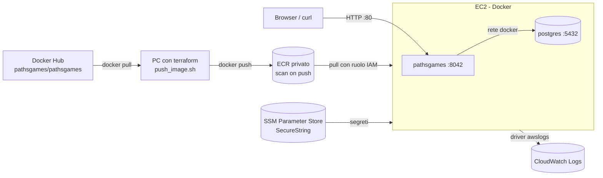

# AWS Esempio 20 - ECR: dall'immagine pubblica al registry privato

Un repository **Amazon ECR** privato dove Terraform copia l'immagine pubblica
[pathsgames/pathsgames](https://hub.docker.com/r/pathsgames/pathsgames) di Docker Hub, e un'istanza
**EC2 con Docker** che la scarica da ECR e la esegue insieme a un container **PostgreSQL**.
I segreti dell'applicazione sono generati da Terraform e salvati su **SSM Parameter Store**, i log dei
container finiscono su **CloudWatch Logs**.

E' la risposta alla domanda *"perche' non uso direttamente Docker Hub?"*: un registry privato nello
stesso account e nella stessa regione non ha limiti di pull, e' raggiungibile con i permessi IAM
invece che con delle credenziali, scansiona le vulnerabilita' a ogni push e tiene sotto controllo
le versioni con una lifecycle policy. Lo stesso repository viene poi usato dall'esempio 21 (ECS).

- ⚠️ Nota importante: l'esecuzione di questi esempi nel cloud puo causare costi indesiderati ⚠️

## Architettura



## L'immagine Paths Games

L'immagine pubblicata su Docker Hub e' il backend Java (Spring Boot) di [Paths Games](https://paths.games),
compilata con il profilo Maven `prod`. Dentro c'e' solo l'adapter **PostgreSQL** (non quello SQLite),
quindi un database serve sempre. Le cose da sapere per eseguirla:

| Aspetto | Valore |
| --- | --- |
| Porta pubblica | `8042` (API, `/api/echo/status` e' l'endpoint di stato) |
| Porta admin | `8044`: non viene pubblicata, resta interna all'istanza |
| Database | `DB_HOST`, `DB_PORT`, `DB_NAME`, `DB_USERNAME`, `DB_PASSWORD` |
| Segreti obbligatori | `JWT_SECRET` e `BANNED_SUBJECT_PEPPER`: fuori da `dev`/`test` l'applicazione **rifiuta di partire** con i valori di default |
| Memoria | circa 550 MB per la JVM, 50 MB per postgres: per questo l'istanza di default e' `t3.small` (2 GB) |

I tre segreti (password del database compresa) sono creati con `random_password` e salvati come
`SecureString`; lo user data li legge con `aws ssm get-parameter` al boot, cosi' non compaiono in
chiaro nello user data dell'istanza (che chiunque abbia `ec2:DescribeInstanceAttribute` puo' leggere).

## Come arriva l'immagine su ECR

Terraform non sa copiare immagini fra registry: la copia la fa lo script [push_image.sh](push_image.sh),
lanciato da una risorsa `terraform_data` con `local-exec` **sul pc che esegue terraform**:

```bash
docker pull --platform <image_platform> <source_image>:<image_tag>
aws ecr get-login-password | docker login --username AWS --password-stdin <account>.dkr.ecr.<region>.amazonaws.com
docker tag <source_image>:<image_tag> <repository_url>:<image_tag>
docker push <repository_url>:<image_tag>
```

La copia viene rifatta solo se cambiano immagine, tag, piattaforma o repository. L'istanza EC2 ha
`depends_on` sulla copia: quando parte, l'immagine e' gia' su ECR.

### Cambiare versione

La versione non e' scritta da nessuna parte nel codice: tutto deriva dalla variabile `image_tag`
(default `1.12.0`, validata come tag Docker). Quando esce una nuova versione
([elenco dei tag](https://hub.docker.com/r/pathsgames/pathsgames/tags)) basta:

```bash
terraform apply -var image_tag=<nuova_versione>   # oppure modificare image_tag in terraform.tfvars
```

e Terraform:
1. rilancia la copia: la nuova immagine si aggiunge su ECR accanto alle precedenti (la lifecycle policy tiene le ultime `max_image_count`)
2. cambia lo user data e, con `user_data_replace_on_change`, ricrea l'istanza che scarica la nuova versione
3. il database sull'istanza riparte vuoto (vedi sotto); le migrazioni Flyway dell'immagine creano lo schema della nuova versione

Per tornare indietro basta rimettere il tag precedente: se e' ancora su ECR la copia lo sovrascrive
con la stessa immagine. L'esempio 21, con `image_tag` vuoto, usa sempre l'ultima immagine copiata qui.

L'alternativa senza Docker locale e' una **pull through cache rule** di ECR: per Docker Hub pero'
richiede comunque delle credenziali Docker Hub salvate su Secrets Manager, per questo qui si e'
preferita la copia esplicita.

Sul repository:
- `scan_on_push = true`: scansione *basic* delle vulnerabilita', il risultato si vede in console o con
  `aws ecr describe-image-scan-findings`
- `force_delete = true`: `terraform destroy` cancella il repository anche se contiene immagini
- lifecycle policy: le immagini senza tag spariscono dopo un giorno, di quelle con tag restano le ultime `max_image_count`

PostgreSQL arriva invece da **ECR Public** (`public.ecr.aws/docker/library/postgres`), il mirror
ufficiale delle immagini Docker: stesso contenuto di Docker Hub, senza i suoi limiti di pull anonimi.

## Tag

Ogni risorsa AWS taggabile riceve i tag comuni del repository (`Name`, `Environment`, `Project`,
`Owner`, `CostCenter`, `ManagedBy`) esplicitamente con `merge(local.common_tags, { Name = ... })`;
in piu' il provider ha `default_tags` come rete di sicurezza. Anche il disco root dell'istanza ha
i suoi tag. Le uniche risorse senza tag sono quelle che non li supportano: `aws_ecr_lifecycle_policy`,
`aws_iam_role_policy_attachment`, `random_password` e `terraform_data` (che non sono risorse AWS).

## File del progetto

| File | Contenuto |
| --- | --- |
| [main.tf](main.tf) | Provider con `default_tags`, locals, VPC/subnet di default, AMI Amazon Linux 2023 |
| [ecr.tf](ecr.tf) | Repository ECR, lifecycle policy, copia dell'immagine |
| [push_image.sh](push_image.sh) | Pull da Docker Hub e push su ECR |
| [secrets.tf](secrets.tf) | Segreti casuali su SSM Parameter Store |
| [ec2.tf](ec2.tf) | Log group, ruolo IAM, security group, istanza |
| [user_data.sh](user_data.sh) | Docker, login ECR, container postgres e pathsgames |

## Configurazione ed esecuzione

Prerequisiti oltre a Terraform: **Docker** in esecuzione e **AWS CLI** configurata sul pc che lancia
`terraform apply` (servono allo script di copia).

```bash
cp terraform.tfvars.example terraform.tfvars
terraform init
terraform plan
terraform apply
```

Le variabili principali:

| Variabile | Default | Descrizione |
| --- | --- | --- |
| `source_image` | `pathsgames/pathsgames` | Immagine di Docker Hub da copiare |
| `image_tag` | `1.12.0` | Versione copiata ed eseguita (meglio una versione precisa di `latest`), vedi *Cambiare versione* |
| `image_platform` | `linux/amd64` | `linux/arm64` per istanze Graviton (l'immagine e' multi-arch) |
| `repository_name` | `""` | Vuoto = `<project_name>-pathsgames`, il nome atteso dall'esempio 21 |
| `max_image_count` | `5` | Immagini con tag mantenute dalla lifecycle policy |
| `instance_type` | `t3.small` | Con 1 GB JVM e postgres insieme vanno in swap o vengono uccisi |
| `host_port` | `80` | Porta dell'istanza su cui viene pubblicata la `8042` del container |
| `http_cidr_blocks` | `["0.0.0.0/0"]` | Chi puo' chiamare l'applicazione |
| `vpc_id` / `subnet_id` | `""` | Vuoti = VPC di default e sua prima subnet |
| `enable_ssh` | `false` | Apre la porta 22 (altrimenti solo SSM) |

## Prova

L'istanza impiega un paio di minuti a installare Docker, scaricare le immagini e avviare la JVM.

```bash
curl -s "$(terraform output -raw url_status)"    # {"status":"OK",...,"env":"aws-esempio20","version":"<image_tag>"}
curl -s "$(terraform output -raw url_stories)"   # l'elenco delle storie pubbliche

# Le immagini nel repository e il risultato della scansione
aws ecr describe-images --repository-name "$(terraform output -raw ecr_repository_name)" \
  --query 'imageDetails[].[imageTags[0],imageScanStatus.status,imagePushedAt]' --output table
aws ecr describe-image-scan-findings --repository-name "$(terraform output -raw ecr_repository_name)" \
  --image-id imageTag="$(terraform output -raw image_tag)" --query 'imageScanFindings.findingSeverityCounts'

# I log dei container
aws logs tail "$(terraform output -raw log_group_name)" --follow
```

Se l'url non risponde dopo cinque minuti, ci si collega all'istanza senza porta 22 e si guarda lo user data:

```bash
aws ssm start-session --target "$(terraform output -raw instance_id)"
sudo tail -50 /var/log/user-data.log
sudo docker ps -a
```

Il database e' in `/opt/pathsgames/pgdata` sul disco dell'istanza: sopravvive ai riavvii dei container
ma non alla ricreazione dell'istanza (cambio di `image_tag`). Per dati persistenti servirebbe RDS (esempio 10).

## Costi

Istanza `t3.small` e disco gp3 da 20 GB a consumo; ECR fa pagare lo spazio occupato (l'immagine
non compressa e' circa 260 MB, su ECR e' salvata compressa) e il traffico verso altre regioni, il pull nella stessa regione e' gratuito.
I parametri SSM standard sono gratuiti.

## Pulizia

```bash
terraform destroy
```

Se l'esempio 21 e' ancora attivo, il suo servizio ECS non potra' piu' scaricare l'immagine: va distrutto prima.

## AlNao.it
Molti esempi presenti in questo repository sono stati creati e pubblicati sul sito [alnao.it](https://www.alnao.it/).

## License
Made with ❤️ by <a href="https://www.alnao.it">AlNao</a>
&bull;
Public projects [GNU General Public License v3.0](https://www.gnu.org/licenses/gpl-3.0.html)
