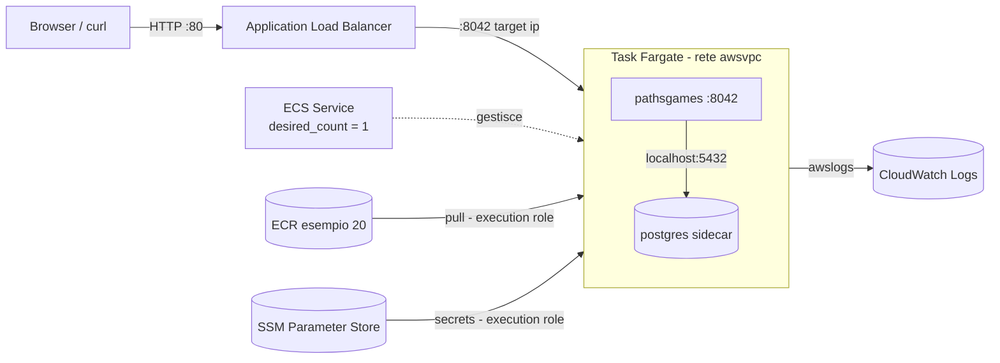

# AWS Esempio 21 - ECS Fargate con l'immagine dell'esempio 20

La stessa immagine [pathsgames/pathsgames](https://hub.docker.com/r/pathsgames/pathsgames) copiata su
**ECR** dall'esempio 20, questa volta eseguita su **Amazon ECS con Fargate**: niente istanze da
gestire, un **service** che tiene in vita il task e lo registra dietro un **Application Load Balancer**.
Nel task gira anche **PostgreSQL** come container *sidecar*; i segreti arrivano da **SSM Parameter
Store** tramite il blocco `secrets` della task definition e i log vanno su **CloudWatch Logs**.

Rispetto all'esempio 20 cambia chi fa il lavoro: li' lo user data installava Docker e lanciava i
container a mano, qui si descrivono i container nella **task definition** ed e' ECS a scaricare
l'immagine, iniettare i segreti, controllare la salute e sostituire i task che muoiono.

- ⚠️ Nota importante: l'esecuzione di questi esempi nel cloud puo causare costi indesiderati ⚠️

## Architettura



## Prerequisito: l'esempio 20

L'immagine viene cercata nel repository ECR `alnao-dev-terraform-esempio20-pathsgames`, quindi
l'esempio 20 va applicato prima. I due data source `aws_ecr_repository` e `aws_ecr_image` fanno
fallire subito il `plan` se repository o immagine mancano, invece di creare un servizio che resta
in errore `CannotPullContainerError`:

```
Error: reading ECR Repository (alnao-dev-terraform-esempio20-pathsgames): couldn't find resource
```

Per provare l'esempio da solo si puo' indicare un'immagine qualsiasi con `container_image`
(per esempio `pathsgames/pathsgames:<versione>` direttamente da Docker Hub): i data source ECR vengono saltati.

### Quale versione

La versione si decide **una volta sola**, con `image_tag` dell'esempio 20. Qui `image_tag` e' vuoto
di default e `aws_ecr_image` usa `most_recent = true`: viene presa l'ultima immagine copiata su ECR.
Aggiornare la versione diventa:

```bash
cd ../AWS-Esempio20-ECR && terraform apply -var image_tag=<nuova_versione>
cd ../AWS-Esempio21-ECS && terraform apply    # nuova revisione della task definition e nuovo deploy
```

Per fissare una versione precisa (per esempio tornare indietro a una ancora presente su ECR) si
valorizza `image_tag` anche qui. In entrambi i casi la task definition riferisce l'immagine per
**digest** (`<repository_url>@sha256:...`) e non per tag: se un tag `MUTABLE` viene sovrascritto
con un'immagine diversa, il digest cambia e Terraform se ne accorge; con il solo tag la task
definition resterebbe identica e ECS continuerebbe a eseguire quella vecchia.

## Task definition: due container, una rete

Con Fargate la rete e' obbligatoriamente `awsvpc`: il task ha **una sola interfaccia di rete**
condivisa da tutti i suoi container, che si parlano su `localhost`. Per questo `DB_HOST` vale
`localhost` invece del nome di un container come nell'esempio 20.

| Container | Cosa fa | Health check |
| --- | --- | --- |
| `postgres` | Database, dati nello storage effimero del task | `pg_isready` |
| `pathsgames` | API sulla `8042`, parte solo quando postgres e' `HEALTHY` (`dependsOn`) | `wget` su `/api/echo/status` (l'immagine alpine non ha curl) |

I segreti non compaiono nella task definition: il blocco `secrets` contiene solo l'ARN del parametro
SSM, e' l'agente ECS a leggerlo (con l'**execution role**) e a passarlo al container come variabile
d'ambiente. I due ruoli IAM hanno compiti distinti:

| Ruolo | Usato da | Permessi |
| --- | --- | --- |
| Execution role | Agente ECS, prima che il container parta | Pull da ECR, scrittura log, lettura dei tre parametri SSM |
| Task role | Applicazione dentro il container | Nessuno (Paths Games non chiama AWS); i canali SSM se `enable_execute_command = true` |

**Il limite del sidecar**: ogni task ha il suo database, che nasce vuoto e muore con il task. Per
questo `desired_count` e' validato a `0` o `1` e il deploy ferma il vecchio task prima di avviare il
nuovo (`deployment_minimum_healthy_percent = 0`, `maximum_percent = 100`): due task dietro lo stesso
ALB avrebbero dati diversi. Per scalare davvero il database va spostato fuori dal task, su RDS
(esempio 10), e a quel punto i task diventano intercambiabili.

## Service e load balancer

- **Target group** di tipo `ip`: con `awsvpc` si registra l'IP del task, non un'istanza; health check su `/api/echo/status`
- `health_check_grace_period_seconds = 120`: il tempo concesso alla JVM (avvio e migrazioni Flyway) prima che l'ALB possa dichiarare il task non sano
- **Deployment circuit breaker** con rollback: se la nuova revisione non diventa sana, ECS torna alla precedente
- Task in subnet pubbliche con IP pubblico, per scaricare l'immagine senza un NAT Gateway (che costerebbe piu' dell'intero esempio); il security group del task accetta solo traffico dall'ALB
- `TRUSTED_PROXIES` vale il CIDR della VPC: l'applicazione considera l'header `X-Forwarded-For` solo se arriva dall'ALB

## Tag

Ogni risorsa AWS taggabile riceve i tag comuni del repository (`Name`, `Environment`, `Project`,
`Owner`, `CostCenter`, `ManagedBy`) esplicitamente con `merge(local.common_tags, { Name = ... })`,
compreso il listener dell'ALB; in piu' il provider ha `default_tags` come rete di sicurezza.
Le risorse create a runtime da ECS sono coperte da `propagate_tags = "SERVICE"` (i task ricevono i
tag del service) ed `enable_ecs_managed_tags` (aggiunge `aws:ecs:clusterName` e `aws:ecs:serviceName`).
Le uniche risorse senza tag sono quelle che non li supportano: `aws_iam_role_policy_attachment`,
`random_password` e `terraform_data`.

**ENI ed Elastic IP dell'ALB.** Un ALB pubblico crea da solo, per ogni nodo, un'interfaccia di
rete e un **Elastic IP gestito dal servizio** (`ServiceManaged = alb`), visibili nella console EC2 fra
gli Elastic IP. Non sono risorse Terraform, l'ALB non propaga loro i suoi tag e il loro numero lo
decide AWS: qui sono 2 nodi su 3 subnet e possono aumentare quando l'ALB scala. Per questo non si
possono gestire con `aws_ec2_tag` e `for_each` (il numero non e' noto al plan): la risorsa
`terraform_data.tag_alb_network` lancia [tag_alb_network.sh](tag_alb_network.sh) dopo la creazione
dell'ALB, che cerca le ENI con descrizione `ELB <arn_suffix>` e gli EIP associati e li tagga
(`Name` = `aws-esempio21.alb-eni` / `aws-esempio21.alb-eip`). Lo script viene rieseguito se cambiano
l'ALB o i tag comuni; se AWS aggiunge nodi in seguito, si ritaggano con:

```bash
terraform apply -replace=terraform_data.tag_alb_network
```

L'IP pubblico dei task Fargate invece non e' un Elastic IP e la loro ENI riceve gia' i tag del
service tramite `propagate_tags`.

## File del progetto

| File | Contenuto |
| --- | --- |
| [main.tf](main.tf) | Provider con `default_tags`, locals, immagine dell'esempio 20, VPC e subnet |
| [secrets.tf](secrets.tf) | Segreti casuali su SSM Parameter Store |
| [iam.tf](iam.tf) | Execution role e task role |
| [alb.tf](alb.tf) | Security group, ALB, target group, listener, tag di ENI ed EIP dell'ALB |
| [tag_alb_network.sh](tag_alb_network.sh) | Tagga ENI ed Elastic IP creati in automatico dall'ALB |
| [ecs.tf](ecs.tf) | Log group, cluster, task definition, service |

## Configurazione ed esecuzione

Oltre a Terraform serve la **AWS CLI** configurata sul pc che lancia `terraform apply` (la usa lo
script che tagga ENI ed EIP dell'ALB).

```bash
cd ../AWS-Esempio20-ECR && terraform apply   # se non gia' fatto: crea ECR e copia l'immagine
cd ../AWS-Esempio21-ECS
cp terraform.tfvars.example terraform.tfvars
terraform init
terraform plan
terraform apply
```

Le variabili principali:

| Variabile | Default | Descrizione |
| --- | --- | --- |
| `ecr_repository_name` | `alnao-dev-terraform-esempio20-pathsgames` | Repository creato dall'esempio 20 |
| `image_tag` | `""` | Vuoto = ultima immagine copiata dall'esempio 20; un tag per fissare la versione |
| `container_image` | `""` | Immagine alternativa (salta ECR), es. `pathsgames/pathsgames:<versione>` |
| `cpu_architecture` | `X86_64` | `ARM64` se l'esempio 20 ha copiato `linux/arm64` |
| `task_cpu` / `task_memory` | `1024` / `2048` | Risorse del task, condivise dai due container |
| `desired_count` | `1` | `0` spegne il servizio senza distruggere ALB e cluster |
| `enable_container_insights` | `false` | Metriche dettagliate del cluster (a pagamento) |
| `enable_execute_command` | `false` | Abilita ECS Exec per aprire una shell nei container |
| `http_cidr_blocks` | `["0.0.0.0/0"]` | Chi puo' chiamare l'ALB |
| `vpc_id` / `subnet_ids` | `""` / `[]` | Vuoti = VPC di default e tutte le sue subnet (l'ALB ne vuole almeno due in AZ diverse) |

## Prova

Dopo l'`apply` il task impiega uno o due minuti a diventare sano dietro l'ALB.

```bash
curl -s "$(terraform output -raw url_status)"    # {"status":"OK",...,"env":"aws-esempio21","version":"<versione dell'immagine>"}
terraform output image_tags                      # i tag dell'immagine in esecuzione
curl -s "$(terraform output -raw url_stories)"

# Stato del servizio e dei deployment
aws ecs describe-services --cluster "$(terraform output -raw cluster_name)" \
  --services "$(terraform output -raw service_name)" \
  --query 'services[0].{running:runningCount,desired:desiredCount,deployments:deployments[].rolloutState}'

# Salute dei target nell'ALB
aws elbv2 describe-target-health --target-group-arn \
  "$(aws elbv2 describe-target-groups --names alnao-dev-terraform-esempio21-tg --query 'TargetGroups[0].TargetGroupArn' --output text)"

# Log dei due container (stream "pathsgames/..." e "postgres/...")
aws logs tail "$(terraform output -raw log_group_name)" --follow
```

Per vedere ECS sostituire un task, basta fermarlo: il service ne avvia subito un altro (con il database di nuovo vuoto).

```bash
TASK=$(aws ecs list-tasks --cluster "$(terraform output -raw cluster_name)" --query 'taskArns[0]' --output text)
aws ecs stop-task --cluster "$(terraform output -raw cluster_name)" --task "$TASK"
```

Con `enable_execute_command = true` si apre una shell nel container (serve il Session Manager plugin della AWS CLI):

```bash
aws ecs execute-command --cluster "$(terraform output -raw cluster_name)" --task "$TASK" \
  --container pathsgames --interactive --command "sh"
```

## Costi

Il task Fargate (1 vCPU, 2 GB) e l'Application Load Balancer si pagano a ore anche senza traffico;
con `desired_count = 0` si ferma il costo del task ma non quello dell'ALB. Dal 2024 anche gli IP
pubblici IPv4 (ALB e task) hanno un costo orario.

## Pulizia

```bash
terraform destroy
```

Va eseguito prima del `destroy` dell'esempio 20, che cancella il repository con l'immagine.

## AlNao.it
Molti esempi presenti in questo repository sono stati creati e pubblicati sul sito [alnao.it](https://www.alnao.it/).

## License
Made with ❤️ by <a href="https://www.alnao.it">AlNao</a>
&bull;
Public projects [GNU General Public License v3.0](https://www.gnu.org/licenses/gpl-3.0.html)
